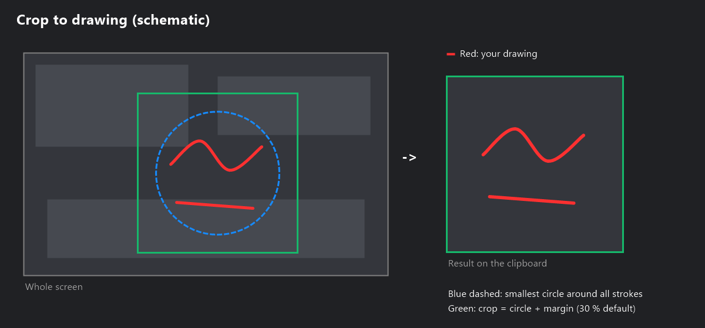

# QuickDrawCapture

A tiny, fast screenshot and drawing tool for Windows 10/11.

Press a shortcut, the screen you are on freezes, scribble on it, press Enter, and only the part you marked is on your clipboard. Paste it anywhere: chat, e-mail, bug reports, AI agents.

**Workflow:** `AltGr + F12` → draw → `Enter` → `Ctrl + V`

## Download

Get the latest build from the [Releases](../../releases) page:

| File | Size | Needs |
|---|---|---|
| `QuickDrawCapture.exe` | about 70 MB | Nothing, runs anywhere. |
| `QuickDrawCapture-small.exe` | about 0.2 MB | The free [.NET 8 Desktop Runtime](https://dotnet.microsoft.com/download/dotnet/8.0) (install once). |

No installer, no internet connection, no account, no telemetry. Just start the EXE.

## Quick start

1. Start the EXE. Nothing opens; a small icon appears in the tray (bottom right, maybe under the `^`).
2. Press **AltGr + F12** (same as `Ctrl + Alt + F12`). The screen where your mouse is freezes.
3. Draw with the mouse.
4. Press **Enter** or **Esc**. The picture is copied and the overlay disappears.
5. Paste with **Ctrl + V** wherever you want.

The program keeps running in the background, so step 2 works again right away.

## The toolbar

A small toolbar floats above the screenshot, by default on the line between the middle and the lower third of the screen. Drag it anywhere you like. It is never part of the copied image.

| Control | What it does |
|---|---|
| 6 colored dots | Pen color: red, blue, green, yellow, white, black. The active one has a white ring. |
| 3 round dots | Pen thickness: thin, medium, thick. |
| Eraser symbol | Click a stroke to remove it. Click again to switch back to the pen. |
| Undo arrow (or `Ctrl + Z`) | Removes the last stroke. |
| Green check | Copy and close, same as Enter. |
| Red X | Close without copying. |

## Keyboard shortcuts

| Shortcut | Action |
|---|---|
| `AltGr + F12` | Capture the screen under the mouse (global, changeable) |
| `Enter` or `Esc` | Copy the result to the clipboard and close (both changeable) |
| `Ctrl + Z` | Undo the last stroke |

## Crop to drawing

Screenshots of a big monitor get huge. By default only the area around your drawing is copied:

1. The program finds the **smallest circle that contains everything you drew** (stroke thickness included).
2. It adds a **margin of 30 %** to the radius (changeable in Settings).
3. The **square around that circle** is copied. If it would stick out of the screen it is pushed back onto it.
4. If you drew nothing, you get the **whole screen**.



## Examples

**Report a bug in one tiny region.** The error message in a huge window: press `AltGr + F12`, circle the message, press `Enter`. Paste into your ticket. You get just the message and a bit of context, not the whole 4K monitor.

**Point an AI agent at the problem.** Press `AltGr + F12`, draw an arrow at the broken button, press `Enter`, paste into the chat. The small image is cheap to send and the arrow shows exactly what you mean.

**Whole screen on purpose.** Turn "Crop to drawing" off in Settings, or draw nothing. Press `Enter` and the whole screen is copied.

**More context around the drawing.** Raise the margin in Settings, for example to `80`. A larger margin shows more of the surroundings.

**Changed your mind.** Press the red X on the toolbar. Nothing is copied.

## Tray icon (right click)

| Entry | What it does |
|---|---|
| Capture now | Same as the capture shortcut. |
| Settings | Change the capture shortcut and the two confirm shortcuts, switch the crop on or off, set the crop margin in percent. |
| Help | Short help inside the program. |
| Exit | Quit the program completely. |

In Settings, click a field and press the new key combination. A capture shortcut needs at least one modifier (Ctrl, Alt, Shift, Win) or an F-key. If another program already uses it, you get a warning and the old shortcut stays active.

## Tips

- Windows may open the Snipping Tool with `PrintScreen`. That is why the default is `AltGr + F12`, which almost nobody uses.
- Several monitors: the screen under the mouse pointer is captured.
- Settings are stored in `%AppData%\QuickDrawCapture\settings.json`. Screenshots are never saved to disk or sent anywhere.
- To start with Windows, press `Win + R`, type `shell:startup`, and put a shortcut to the EXE in that folder.

## Build from source

Requires the .NET 8 SDK.

```powershell
dotnet publish .\QuickDrawCapture\QuickDrawCapture.csproj -c Release -r win-x64 --self-contained true /p:PublishSingleFile=true
```

## License

MIT. Everyone may use, copy, modify and share it. See [LICENSE](LICENSE).

Version 0.1, by fifdesign, 2026.
